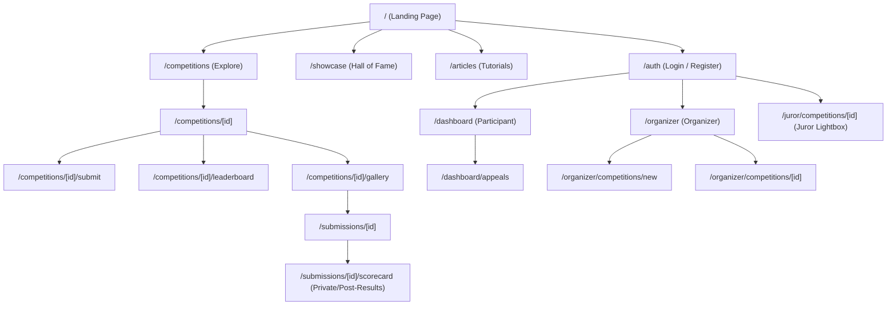
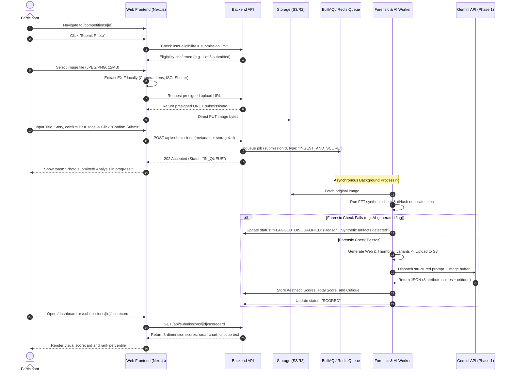
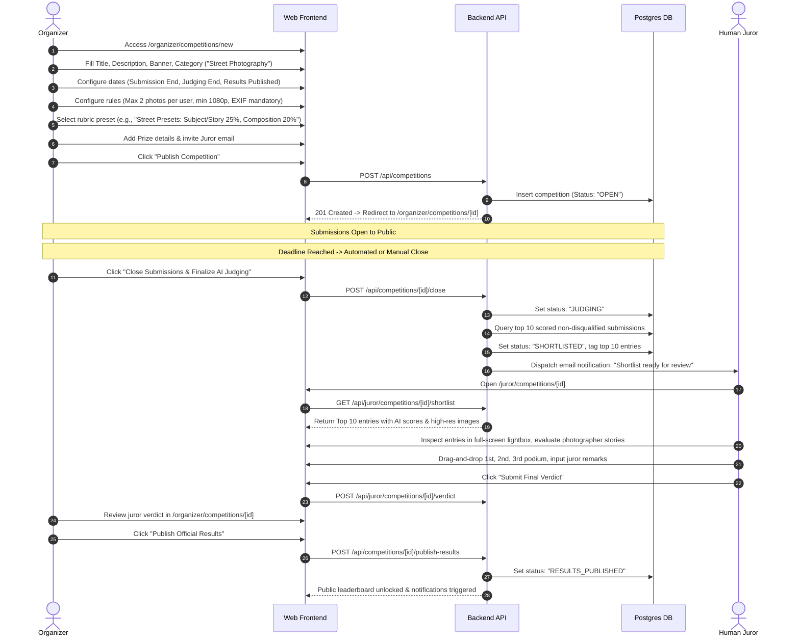
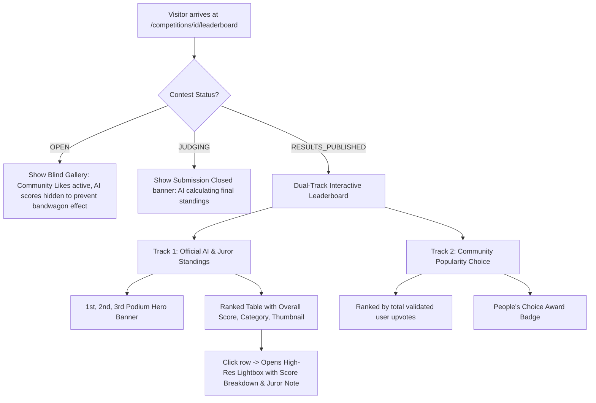
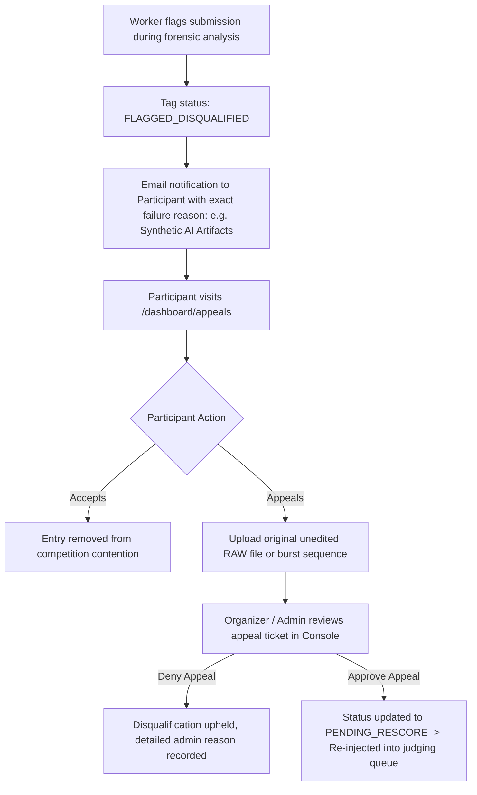

# 03: User Flows and Pages

> **Document Version:** 1.0.0  
> **Status:** Approved Baseline  
> **Target Audience:** UI/UX Designers, Frontend Engineers, Full-Stack Developers  
> **Related Documents:**  
> - [01_project_overview.md](file:///c:/Users/prems/OneDrive/Desktop/projects/Image-Aesthetics-Assessment-/docs/01_project_overview.md)  
> - [02_product_requirements.md](file:///c:/Users/prems/OneDrive/Desktop/projects/Image-Aesthetics-Assessment-/docs/02_product_requirements.md)  
> - [04_competition_system.md](file:///c:/Users/prems/OneDrive/Desktop/projects/Image-Aesthetics-Assessment-/docs/04_competition_system.md)  
> - [12_ui_ux_guidelines.md](file:///c:/Users/prems/OneDrive/Desktop/projects/Image-Aesthetics-Assessment-/docs/12_ui_ux_guidelines.md)

---

## 1. Application Route & Screen Inventory

The following table provides the exhaustive routing hierarchy of the Pixel Prize web application:

| Route Pattern | Page Title | Access Level | Description & Core Components |
| :--- | :--- | :--- | :--- |
| `/` | Home / Landing Page | Public | Hero showcase, active marquee competitions, AI evaluation demo interactive widget, winner gallery reel, value proposition metrics. |
| `/competitions` | Explore Competitions | Public | Search and filtering directory (category, status, prize pool, deadline), contest cards with live countdown timers (`GuruShots`). |
| `/competitions/[id]` | Competition Details | Public | Contest overview, themes, rules, prize tiers, submission limits, timeline bar, "Submit Entry" primary CTA, public entry gallery. |
| `/competitions/[id]/submit` | Submit Photo | Participant | Multi-step photo upload, real-time client-side EXIF extractor, title, category tag, artistic story input, preview card. |
| `/competitions/[id]/leaderboard` | Live / Final Leaderboard | Public | Dual-track leaderboard (`Photocrowd`): AI Aesthetic Score ranking vs. Community Votes ranking; filterable by category. |
| `/competitions/[id]/gallery` | Public Gallery | Public | Infinite-scroll masonry grid with progressive image loading, EXIF overlay badge on hover, community like button. |
| `/submissions/[id]` | Submission View | Public | High-resolution image viewport, photographer attribution (unmasked post-judging), EXIF metadata sidebar, story text. |
| `/submissions/[id]/scorecard`| AI Diagnostic Scorecard | Private / Participant | Granular 8-attribute radar chart, technical defect flags, 100–150 word critique commentary (`ArtiMuse`), percentile ranking. |
| `/dashboard` | Participant Dashboard | Participant | Unified creator portal (`Devfolio`): entered contests, submission statuses (Ingested, In Queue, Scored, Shortlisted), aggregate stats. |
| `/dashboard/appeals` | Disqualification Appeals | Participant | View flagged photos, inspect forensic rejection reason (AI render, missing EXIF), submit dispute ticket or RAW verification. |
| `/organizer` | Organizer Portal | Organizer | Organizer landing page: list of hosted competitions, submission volume telemetry, quick actions. |
| `/organizer/competitions/new`| Create Competition Wizard| Organizer | Multi-step wizard: Basic info $\rightarrow$ Rules & Caps $\rightarrow$ Dates $\rightarrow$ Rubric Weights $\rightarrow$ Prizes & Sponsors $\rightarrow$ Publish. |
| `/organizer/competitions/[id]`| Contest Management Console| Organizer | Live ingestion monitor, queue throughput, flagged items review, state transition controls (Close Submissions, Run Shortlist). |
| `/juror/competitions/[id]` | Juror Review Lightbox | Juror | Distraction-free full-screen review of Top 10 shortlisted finalists, side-by-side AI breakdowns, podium drag-and-drop ranking. |
| `/showcase` | Hall of Fame / Winners | Public | Permanent gallery of past competition winners, honorable mentions, and highlighted critiques. |
| `/articles` | Educational Articles | Public | Editorial tutorials on photographic techniques, composition theory, lighting, and how AI perceives visual aesthetics. |
| `/settings` | User Profile & Settings | Authenticated | Account settings, bio, portfolio links, camera gear list, notification preferences. |

---

## 2. Global Navigation & Information Architecture

---

## 3. End-to-End User Flows

### 3.1 Flow 1: Participant Signup $\rightarrow$ Join Contest $\rightarrow$ Upload $\rightarrow$ AI Scoring

---

### 3.2 Flow 2: Organizer Creates & Runs Competition $\rightarrow$ Juror Shortlist Handoff

---

### 3.3 Flow 3: Public Leaderboard & Gallery Engagement (`Photocrowd` / `GuruShots` Model)

---

### 3.4 Flow 4: Disqualification & Appeals Workflow

---

## 4. Key Page Layouts & Component Architecture

### 4.1 Competition Detail Page (`/competitions/[id]`)
- **Header Banner:** High-resolution cover photo, competition title, organizer avatar/organization badge, category pills, prize purse highlight (e.g., "$2,500 Prize Pool").
- **Timeline Stepper:** Visual timeline indicating current lifecycle state:
  `Announced` $\rightarrow$ `Submissions Open` [ACTIVE] $\rightarrow$ `Judging` $\rightarrow$ `Results`. Includes real-time countdown timer.
- **Rules & Rubrics Accordion:**
  - Submission caps (e.g., "Max 2 entries per photographer").
  - Technical requirements (minimum $1920\times1080$, EXIF preservation required).
  - Aesthetic rubric breakdown table showing attribute weights (Composition 25%, Lighting 20%, etc.).
- **Prize Cards:** 1st, 2nd, 3rd place cash/award details and sponsor logos.
- **Action Sticky Bar:** Prominent "Submit Photo" button (or "View Leaderboard" if finished).

### 4.2 Photo Submission Modal (`/competitions/[id]/submit`)
- **Dropzone Area:** Drag-and-drop zone with instant thumbnail preview and file size/type validation.
- **Automated EXIF Extraction Card:**
  - Displays parsed parameters: `Camera Model`, `Lens`, `Focal Length`, `Aperture`, `Shutter Speed`, `ISO`.
  - Alert indicator if EXIF is missing: *"Warning: Photos without camera metadata undergo deeper forensic inspection and may be penalized."*
- **Creative Story & Context Inputs:**
  - `Title` (required, max 80 chars).
  - `Category` selection (within contest themes).
  - `Story / Concept Behind the Shot` (optional, max 500 chars).
- **Declaration Checkboxes:**
  - [x] "I confirm that I own full copyright to this photograph."
  - [x] "I certify this is an authentic photograph, not generated by AI diffusion or generative models."
  - [x] "I agree to the Pixel Prize terms of service and competition rules."

### 4.3 AI Diagnostic Scorecard (`/submissions/[id]/scorecard`)
- **Hero Image Split-View:**
  - Left column: The submitted photograph in high-resolution with zoom capability.
  - Right column: Overall Aesthetic Score ($0\text{--}100$) rendered as a circular progress ring with percentile ranking (e.g., "Top 8% in Street Photography").
- **Radar Chart Component:**
  - Interactive 8-axis polygon mapping the 8 core attributes: Composition, Lighting, Color Harmony, Technical Quality, Subject/Story, Originality, Emotion, Overall Gestalt.
- **Detailed Attribute Cards:**
  - 8 progress bars with numerical scores ($0\text{--}100$) and short descriptor labels (e.g., "Exceptional", "Strong", "Average").
- **Constructive Critique Box (`ArtiMuse` format):**
  - Section 1: *Composition & Visual Strengths* (e.g., "Strong leading lines converging on the subject...").
  - Section 2: *Technical Execution* (e.g., "Slight motion blur detected in lower left corner...").
  - Section 3: *Actionable Recommendations* (e.g., "Consider stopping down to f/5.6 to sharpen edge detail...").
- **Technical & Forensics Badge:**
  - Green checkmark: "EXIF Verified (Sony A7 IV, 24-70mm f/2.8)".
  - Green checkmark: "FFT Frequency Forensics: Authentic Sensor Signature".

### 4.4 Juror Review Lightbox (`/juror/competitions/[id]`)
- **Full-Screen Darkroom UX:** Minimal distraction dark-gray UI ($#0F1117$).
- **Top 10 Strip Carousel:** Horizontal thumbnail ribbon at the bottom with quick keyboard navigation (`Arrow Left` / `Arrow Right`).
- **Inspection Tools:** 100% 1:1 pixel zoom loupe, histogram toggle, EXIF inspector overlay.
- **AI Scoring Companion Sidebar:** Collapsible drawer showing the AI's attribute breakdown and critique notes as a second opinion.
- **Podium Ranking Dock:** Drag-and-drop ranking slots:
  - Gold Podium: 1st Place ($+\text{Juror Note}$)
  - Silver Podium: 2nd Place
  - Bronze Podium: 3rd Place
  - Honorable Mention (Slots 4–5)
- **Confirm & Sign-Off CTA:** Requires explicit juror digital signature/confirmation before submitting to the organizer.
