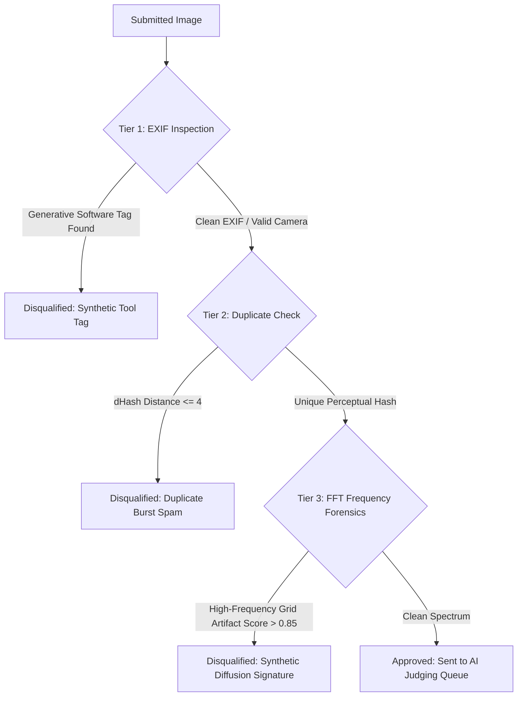

# 04: Competition System Specification

> **Document Version:** 1.0.0  
> **Status:** Approved Baseline  
> **Target Audience:** Backend Engineers, System Architects, Product Operations  
> **Related Documents:**  
> - [01_project_overview.md](file:///c:/Users/prems/OneDrive/Desktop/projects/Image-Aesthetics-Assessment-/docs/01_project_overview.md)  
> - [02_product_requirements.md](file:///c:/Users/prems/OneDrive/Desktop/projects/Image-Aesthetics-Assessment-/docs/02_product_requirements.md)  
> - [03_user_flows_and_pages.md](file:///c:/Users/prems/OneDrive/Desktop/projects/Image-Aesthetics-Assessment-/docs/03_user_flows_and_pages.md)  
> - [05_ai_judging_system.md](file:///c:/Users/prems/OneDrive/Desktop/projects/Image-Aesthetics-Assessment-/docs/05_ai_judging_system.md)  
> - [10_database_schema.md](file:///c:/Users/prems/OneDrive/Desktop/projects/Image-Aesthetics-Assessment-/docs/10_database_schema.md)

---

## 1. Competition Lifecycle State Machine

The competition lifecycle transitions deterministically across six states based on time triggers and organizer actions. This state machine expands upon the competition workflow in *Pan Zhang (2018)* (Paper 1, Section 3.3.6 & Table A.7) and *Devfolio* contest structures:

```mermaid
stateDiagram-v2
    [*] --> DRAFT: Organizer Creates Contest
    
    DRAFT --> OPEN: Organizer Publishes Contest (Start Date Reached)
    DRAFT --> CANCELLED: Organizer Deletes Draft
    
    OPEN --> SUBMISSIONS_CLOSED: Submission Deadline Reached (T_sub)
    OPEN --> JUDGING: Manual Close Triggered by Organizer
    
    SUBMISSIONS_CLOSED --> JUDGING: AI Processing Queue Drained & Verified
    
    JUDGING --> SHORTLISTED: AI Scoring Complete; Top 10 Identified
    
    SHORTLISTED --> RESULTS_PUBLISHED: Juror Podiums Confirmed & Published
    
    RESULTS_PUBLISHED --> ARCHIVED: Retention Period Closes (T_archive)
    
    CANCELLED --> [*]
    ARCHIVED --> [*]
```



### State Definitions & Access Rules

| Lifecycle State | Trigger / Prerequisite | Participant Permissions | Public Permissions | Organizer / Juror Permissions |
| :--- | :--- | :--- | :--- | :--- |
| **`DRAFT`** | Initial creation via wizard | None (hidden) | None (hidden) | Organizer can edit all fields, rubrics, prizes, and delete. |
| **`OPEN`** | `currentTime >= startDate` AND status is published | Can upload photos, edit draft submissions, view blind gallery | Can view overview, rules, blind gallery, vote in community track | Organizer can monitor ingestion telemetry; cannot alter rubrics or end date downwards. |
| **`SUBMISSIONS_CLOSED`**| `currentTime >= submissionEndDate` | Submissions locked; can view own submission status | Can view blind gallery | Organizer can trigger batch judging if not auto-queued. |
| **`JUDGING`** | Ingestion closed; AI queue executing | Submissions read-only; waiting for scorecards | Gallery hidden or showing "Judging in Progress" | Real-time queue progress monitor visible to Organizer. |
| **`SHORTLISTED`** | All active submissions scored; Top 10 generated | Can view own diagnostic scorecard privately | Gallery hidden or previewing finalists | Juror accesses Juror Lightbox to review Top 10 and select podium. |
| **`RESULTS_PUBLISHED`**| Juror votes finalized; Organizer clicks "Publish" | Can view public ranking, certificates, scorecard | Full public leaderboard, winner showcase, critiques unlocked | Read-only audit log; can generate reports and award certificates. |
| **`ARCHIVED`** | 180 days post-results (`T_archive`) | Read-only view in profile history | Read-only permanent public hall of fame | Historical record; storage cold-tier optimization. |

---

## 2. Categories, Themes & Theme Conditioning

Aesthetic evaluation is inherently dependent on genre semantics (*He et al., TAD66K, Paper 3*). A portrait is judged on facial lighting, emotional expression, and background separation, while architecture is judged on rectilinear geometry, perspective vanishing lines, and structural texture.

Pixel Prize implements **Nine Core Standard Categories** mapped directly to the 47 themes in TAD66K:

| Category Code | Display Name | TAD66K / Benchmark Mapping | Primary Aesthetic Focus (*ArtiMuse / IAACLIP*) |
| :--- | :--- | :--- | :--- |
| `LANDSCAPE` | Landscape & Nature | Mountain, Lake, Forest, Sunset, Sky | Depth, negative space, horizon balance, dynamic range, color harmony. |
| `PORTRAIT` | Portrait & People | Portrait, Face, Human, Fashion | Eye sharpness, facial lighting, expression/mood, background bokeh. |
| `STREET` | Street & Documentary | Street, Urban, Crowd, Transit | Decisive moment, narrative story, candid authenticity, leading lines. |
| `WILDLIFE` | Wildlife & Animals | Animals, Birds, Insects, Marine | Subject isolation, eye tracking focus, action freeze, natural lighting. |
| `MACRO` | Macro & Micro | Flower, Insect Close-up, Texture | Depth of field accuracy, micro-contrast, intricate pattern repetition. |
| `ARCHITECTURE`| Architecture & Interior| Buildings, Interior, Facades, Bridges| Geometric symmetry, vertical vanishing lines, structural balance, perspective. |
| `NIGHT` | Night & Astro | Night Scene, Stars, Astrophotography, City Lights| Low noise at high ISO, highlight recovery, star pinpoint sharpness, mood. |
| `MONOCHROME` | Black & White | B&W variants of all scenes | Tonal dynamic range, zone system contrast, texture, light/shadow drama. |
| `CONCEPTUAL` | Conceptual & Fine Art | Surreal, Abstract, Still Life | Inventive originality, symbolic narrative, gestalt cohesion, unconventional visual idea. |

---

## 3. Submission Rules & Constraints Engine

Every competition enforces strict validation rules before accepting an uploaded asset into the judging pipeline:

### 3.1 Submission Limits
- **Quota per User:** Organizer sets `maxEntriesPerUser` (Default: $2$, Allowed Range: $1\text{ to }5$).
- **Single Category Rule:** In multi-category contests, a single image cannot be entered into more than one category simultaneously.
- **Perceptual Duplicate Cap (`Aftershoot` model):** The system computes a 64-bit difference hash (`dHash`) on upload. If Hamming Distance $H(h_1, h_2) \le 4$ against any image already submitted by the user across any active contest, the upload is rejected:
  $$\text{Reject if: } H(dHash(I_{new}), dHash(I_{existing})) \le 4$$
  *(Prevents burst shooting spam where a user submits 5 micro-variations of the same scene).*

### 3.2 Technical Image Specifications
- **Allowed MIME Types:** `image/jpeg`, `image/png`, `image/webp`. (No HEIC or raw camera files in Phase 1).
- **Maximum File Size:** $25.0\text{ MB}$ (prevents S3 exhaustion and buffer overflows).
- **Minimum Resolution:** $1920\text{ pixels}$ along the longest edge. Total megapixels $\ge 2.0\text{ MP}$.
- **Color Space:** sRGB or Adobe RGB (automatically converted to sRGB during web variant rendering).

### 3.3 EXIF Metadata Policy
- **Mandatory vs. Optional:** Organizers can toggle `requireExif` (Default: `TRUE`).
- **Required Hardware Tags:** If `requireExif = TRUE`, the following metadata tags must be present and valid:
  - `Make` & `Model` (Camera hardware manufacturer and model)
  - `FocalLength`
  - `ExposureTime` (Shutter speed)
  - `FNumber` (Aperture)
  - `ISOSpeedRatings`
- **Grace Policy:** If EXIF is stripped (e.g., exported via certain mobile apps), the upload is accepted only if `requireExif = FALSE`, but the system flags the photo for **Enhanced Forensic Inspection (Level 2 FFT)**.

---

## 4. Disqualification Matrix & Forensics

To protect human photography competitions from bad actors and synthetic generators (`Presentation1.pptx`, Slide 4), Pixel Prize executes an automated three-tier forensic check during ingestion:



### Forensic Violations Table

| Violation Code | Forensic Mechanism | Severity | Automatic System Action |
| :--- | :--- | :--- | :--- |
| `DQ_SYNTHETIC_EXIF` | Software metadata indicates generative tool (e.g., `Midjourney`, `Stable Diffusion`, `ComfyUI`, `NovelAI`, `DALL-E`). | Fatal | Immediate Disqualification; Status `FLAGGED_DISQUALIFIED`. |
| `DQ_FFT_DIFFUSION` | Fast Fourier Transform shows abnormal high-frequency periodic lattice artifacts characteristic of latent diffusion upscalers. | Fatal | Flagged; Status `FLAGGED_DISQUALIFIED` (Requires manual appeal). |
| `DQ_DUPLICATE_BURST` | $dHash$ Hamming distance $\le 4$ against another submission by the same user. | Fatal | Rejected at upload time with UI error message. |
| `DQ_WATERMARK_DETECT` | Large visible copyright watermark, promotional URL, or photographer name overlay detected by OCR/Vision filter. | Soft Penalty | $-15$ points deduction on Technical Execution; warned in critique. |
| `DQ_NSFW_CONTENT` | Google Cloud Vision / Gemini safety filter flags adult, violent, or hate imagery. | Fatal | Immediate Disqualification; image quarantined; user flagged. |

---

## 5. Shortlisting & Podium Selection Workflow

Pixel Prize bridges the scalability gap by implementing a **Hybrid AI-Human Shortlist Workflow** (`Presentation1.pptx`, Slide 2 & 3):

```
+-----------------------------------------------------------------------------------+
|                           PHASE 1: BULK AI EVALUATION                             |
|  - 5,000+ Submissions                                                             |
|  - Automated Ingestion, Forensics, and 8-Attribute Aesthetic Scoring              |
|  - Entries ranked by Total Normalized Aesthetic Score (0-100)                     |
+-----------------------------------------------------------------------------------+
                                         │
                                         ▼
+-----------------------------------------------------------------------------------+
|                       PHASE 2: VERIFIED TOP 10 SHORTLIST                          |
|  - Highest-scoring non-disqualified entries per category (Rank 1 to 10)           |
|  - Forensic audit logs verified; EXIF confirmed authentic                         |
+-----------------------------------------------------------------------------------+
                                         │
                                         ▼
+-----------------------------------------------------------------------------------+
|                        PHASE 3: HUMAN JUROR PODIUM VOTE                           |
|  - Appointed Juror(s) evaluate Top 10 finalists in Juror Lightbox                 |
|  - Human Juror selects:                                                           |
|       * 1st Place (Gold Podium)                                                   |
|       * 2nd Place (Silver Podium)                                                 |
|       * 3rd Place (Bronze Podium)                                                 |
|       * Honorable Mentions (Slots 4-5)                                            |
|  - Jurors add personalized qualitative commendation notes                         |
+-----------------------------------------------------------------------------------+
                                         │
                                         ▼
+-----------------------------------------------------------------------------------+
|                   PHASE 4: RESULTS PUBLISHING & CELEBRATION                       |
|  - Organizer approves juror verdict -> Official Standings Published               |
|  - Dynamic Leaderboard unlocks; Diagnostic Scorecards released to all entrants    |
+-----------------------------------------------------------------------------------+
```

---

## 6. Appeals & Dispute Resolution System

To maintain community trust and prevent false-positive AI disqualifications:

1. **Dispute Window:** A 48-hour appeal window opens upon notification of disqualification.
2. **Acceptable Proof of Authenticity:**
   - **Original RAW File:** Entrant uploads the raw proprietary file (`.CR2`, `.CR3`, `.NEF`, `.ARW`, `.DNG`) matching the exact timestamp and camera serial number of the entry.
   - **Bracketed Sequence:** Entrant uploads the preceding and succeeding frame shots from the original burst sequence.
3. **Resolution Escalation:**
   - Appeals are submitted to the **Organizer Console (`/organizer/competitions/[id]`)**.
   - The Organizer or Admin reviews the unedited raw file.
   - If approved, the status is updated to `PENDING_RESCORE` and automatically re-queued for full AI evaluation.
