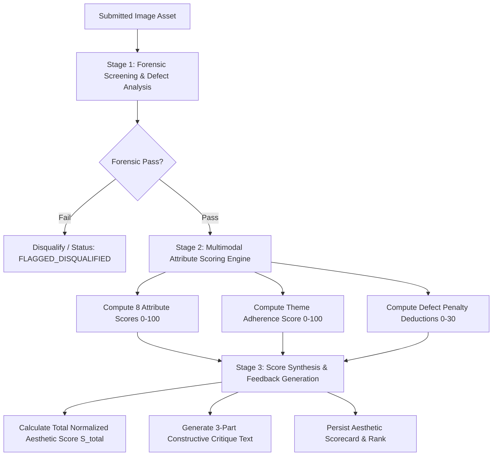

# 05: AI Judging System Specification

> **Document Version:** 1.0.0  
> **Status:** Core Foundation (Most Critical System Specification)  
> **Target Audience:** AI Engineers, Computer Vision Researchers, Backend Developers  
> **Scientific Foundations:**  
> - *ArtiMuse* (Cao et al., CVPR 2026 - Paper 2): 8-Dimension Rubric & Expert Critique Generation  
> - *TAD66K & TANet* (He et al., IJCAI/CVPR - Paper 3): Theme-Conditioned Aesthetic Evaluation  
> - *IAACLIP* (Li et al., MDPI Electronics 2025 - Paper 4): Photographic Composition Rules & Multimodal Alignment  
> - *EAMB-Net* (Chen et al., IEEE TIM 2024): Emotion-Aware Aesthetic Mapping  
> - *Pixel Prize Research* (Presentation 1 & Aftershoot Reference): Forensic & Defect Screening  
> **Related Documents:**  
> - [04_competition_system.md](file:///c:/Users/prems/OneDrive/Desktop/projects/Image-Aesthetics-Assessment-/docs/04_competition_system.md)  
> - [06_prompt_library.md](file:///c:/Users/prems/OneDrive/Desktop/projects/Image-Aesthetics-Assessment-/docs/06_prompt_library.md)  
> - [07_model_abstraction_and_migration.md](file:///c:/Users/prems/OneDrive/Desktop/projects/Image-Aesthetics-Assessment-/docs/07_model_abstraction_and_migration.md)

---

## 1. Architectural Philosophy: The Three-Stage Judging Pipeline

Aesthetic appreciation in human experts is not a single black-box intuition. It is a hierarchical cognition process that evaluates:
1. **Provenance & Integrity:** Is this an authentic optical photograph or a synthetic render?
2. **Technical Mastery:** Is the image properly focused, exposed, and free of optical defects?
3. **Artistic & Aesthetic Merit:** How effectively do composition, light, color, and narrative provoke emotional and aesthetic response?

Pixel Prize formalizes this cognition into an automated three-stage pipeline:



---

## 2. The 8-Dimension Aesthetic Scoring Rubric

Grounded in **ArtiMuse (CVPR 2026)** and **IAACLIP (2025)**, photos are evaluated on eight orthogonal dimensions on a continuous scale of $0.0\text{ to }100.0$:

| Dimension ($k$) | Code | Semantic Definition | High Score Indicators ($85\text{--}100$) | Low Score Indicators ($0\text{--}50$) |
| :--- | :--- | :--- | :--- | :--- |
| **1. Composition & Structure** | `COMPOSITION` | Structural arrangement, visual balance, geometric harmony, and spatial flow. | Masterful rule of thirds, dynamic diagonals, intentional negative space, clear leading lines (*IAACLIP* rules). | Cluttered visual chaos, tilted horizons without intent, distracting tangent lines, unbalanced framing. |
| **2. Lighting & Exposure** | `LIGHTING` | Control over illumination, contrast ratio, dynamic range, and highlight/shadow tonality. | Rich tonal range, intentional specular highlights, preserved shadow detail, evocative directional light. | Blown-out clipped highlights, muddy crushed shadows, harsh unflattering direct flash, flat lighting. |
| **3. Color Harmony & Palette** | `COLOR` | Chromatic balance, palette cohesion, color contrast, and grading mood (*RGBNet* principles). | Coherent analogous or complementary color scheme, sophisticated grading, natural skin tones. | Oversaturated garish colors, unnatural color casts, conflicting hues clashing without purpose. |
| **4. Technical Execution** | `TECHNICAL` | Sharpness, focus accuracy, noise/grain management, depth of field control. | Tack-sharp focal plane on critical subject (e.g., iris of eye), clean sensor output, crisp micro-contrast. | Missed critical focus, camera shake / motion blur, excessive digital noise, severe chromatic aberration. |
| **5. Subject & Storytelling** | `STORY` | Clarity of subject, narrative power, emotional moment, and conceptual depth. | Evocative "decisive moment", powerful human interest or narrative drama, compelling storytelling. | Ambiguous or hidden subject, lack of purpose, boring snapshot aesthetic, disconnected elements. |
| **6. Originality & Creativity** | `ORIGINALITY` | Inventive perspective, unique vision, departure from visual clichés. | Unconventional camera angle, imaginative conceptual framing, fresh interpretation of subject. | Generic tourist postcard composition, visual cliché, derivative execution without novelty. |
| **7. Emotion & Atmosphere** | `EMOTION` | Mood conveyance, viewer empathy, visceral resonance (*EAMB-Net* principles). | Deep emotional resonance (serenity, melancholy, awe, joy), palpable atmospheric tension. | Sterile, emotionally inert, clinically dry documentation lacking soul. |
| **8. Overall Gestalt** | `GESTALT` | Holistic visual integration; whether the whole exceeds the sum of its individual parts. | Perfect synergy between light, subject, and framing; complete visual rhythm and completeness. | Fragmented parts that fail to unite into a cohesive photographic statement. |

---

## 3. Mathematical Scoring Formulation

### 3.1 The Total Normalized Aesthetic Score ($S_{total}$)

The final score awarded to a submission is calculated using the following deterministic formula:

$$S_{total} = \max\left(0, \min\left(100, \left( \sum_{k=1}^8 w_k \cdot S_k \right) \times \left(\frac{S_{theme}}{100}\right) - P_{defect} \right)\right)$$

Where:
- $S_k \in [0, 100]$: The score awarded to attribute $k$.
- $w_k \in (0, 1)$: The category-specific weight for attribute $k$, strictly constrained such that:
  $$\sum_{k=1}^8 w_k = 1.0$$
- $S_{theme} \in [0, 100]$: The Theme Adherence Multiplier (*He et al., TAD66K*). If an image violates the competition theme, its aesthetic score is proportionately scaled down.
- $P_{defect} \in [0, 30]$: Cumulative technical defect penalty points derived from the defect analysis engine (*Aftershoot* inspection).

---

## 4. Per-Category Rubric Weight Configurations

In alignment with **TAD66K (Paper 3)**, different categories demand distinct evaluation weights:

| Category | $w_{comp}$ | $w_{light}$ | $w_{color}$ | $w_{tech}$ | $w_{story}$ | $w_{orig}$ | $w_{emot}$ | $w_{gest}$ | Rationale |
| :--- | :---: | :---: | :---: | :---: | :---: | :---: | :---: | :---: | :--- |
| **Default / General** | $0.20$ | $0.15$ | $0.15$ | $0.15$ | $0.15$ | $0.10$ | $0.05$ | $0.05$ | Balanced baseline for general photography. |
| **Landscape & Nature** | **$0.25$** | **$0.20$** | **$0.20$** | $0.15$ | $0.05$ | $0.05$ | $0.05$ | $0.05$ | Heavy emphasis on composition, horizon balance, and natural light/color. |
| **Portrait & People** | $0.15$ | **$0.20$** | $0.10$ | **$0.20$** | **$0.20$** | $0.05$ | $0.10$ | $0.00$ | Crucial focus on eye sharpness, lighting flattering the subject, and expression. |
| **Street Photography** | $0.15$ | $0.10$ | $0.05$ | $0.05$ | **$0.30$** | **$0.20$** | **$0.15$** | $0.00$ | Storytelling and the "decisive moment" dominate; technical perfection is deprioritized. |
| **Macro & Micro** | $0.15$ | $0.15$ | $0.15$ | **$0.35$** | $0.05$ | $0.05$ | $0.05$ | $0.05$ | Extreme precision on sharpness, depth of field plane, and optical clarity. |
| **Architecture** | **$0.30$** | $0.15$ | $0.10$ | $0.20$ | $0.05$ | $0.10$ | $0.00$ | **$0.10$** | Geometric perspective, symmetry, vertical convergence, and structural gestalt. |
| **Monochrome** | $0.20$ | **$0.30$** | $0.00$ | $0.15$ | $0.15$ | $0.10$ | $0.05$ | $0.05$ | Color weight set to $0$; light, shadow, tonal contrast, and zone range dominate. |

---

## 5. Technical Defect Deductions ($P_{defect}$)

Inspired by **Aftershoot's automated defect culling algorithms**, the AI inspects images for objective photographic errors and deducts points from $P_{defect}$:

| Defect Code | Defect Description | Penalty Range | Automated Detection Indicator |
| :--- | :--- | :---: | :--- |
| `DEF_BLUR_MOTION` | Accidental camera shake or slow shutter motion blur on stationary subject. | $5\text{--}15\text{ pts}$ | Laplacian variance $< 80$ across high-contrast subject edges. |
| `DEF_FOCUS_MISS` | Critical subject soft/out-of-focus while background is sharply focused. | $10\text{--}20\text{ pts}$ | Edge gradient magnitude on detected subject lower than background. |
| `DEF_HIGHLIGHT_CLIP`| Severe highlight blowout without aesthetic intent (blown skies/skin). | $5\text{--}10\text{ pts}$ | Greater than $8\%$ of image pixels at luminance $Y = 255$ with abrupt clipping. |
| `DEF_NOISE_EXTREME` | Excessive high-ISO chroma noise or sensor banding degrading textures. | $5\text{--}12\text{ pts}$ | High spatial high-frequency chromatic variance in flat shadow regions. |
| `DEF_BLINK_CLOSED` | Subject in portrait has closed eyes / awkward blink expression. | $10\text{--}15\text{ pts}$ | Facial landmark aspect ratio on eye contours $< 0.15$ without artistic intent. |
| `DEF_SENSOR_DUST` | Visible dark sensor dust spots in high-key skies. | $3\text{--}5\text{ pts}$ | Circular Gaussian spot anomalies in low-frequency sky areas. |

---

## 6. Structured Output Schema (`AestheticEvaluationSchema`)

To guarantee deterministic parsing by downstream services, the AI judging engine must return a strictly formatted JSON payload conforming to the following JSON Schema:

```json
{
  "$schema": "http://json-schema.org/draft-07/schema#",
  "title": "AestheticEvaluationSchema",
  "type": "object",
  "required": [
    "overallScore",
    "themeAdherenceScore",
    "attributeScores",
    "detectedCompositionRules",
    "defectDeductions",
    "critique",
    "forensicsSummary"
  ],
  "properties": {
    "overallScore": {
      "type": "number",
      "minimum": 0.0,
      "maximum": 100.0,
      "description": "Final computed normalized score S_total"
    },
    "themeAdherenceScore": {
      "type": "number",
      "minimum": 0.0,
      "maximum": 100.0,
      "description": "Adherence score to the specified category theme"
    },
    "attributeScores": {
      "type": "object",
      "required": [
        "composition",
        "lighting",
        "colorHarmony",
        "technicalExecution",
        "subjectStory",
        "originality",
        "emotionAtmosphere",
        "overallGestalt"
      ],
      "properties": {
        "composition": { "type": "number", "minimum": 0, "maximum": 100 },
        "lighting": { "type": "number", "minimum": 0, "maximum": 100 },
        "colorHarmony": { "type": "number", "minimum": 0, "maximum": 100 },
        "technicalExecution": { "type": "number", "minimum": 0, "maximum": 100 },
        "subjectStory": { "type": "number", "minimum": 0, "maximum": 100 },
        "originality": { "type": "number", "minimum": 0, "maximum": 100 },
        "emotionAtmosphere": { "type": "number", "minimum": 0, "maximum": 100 },
        "overallGestalt": { "type": "number", "minimum": 0, "maximum": 100 }
      }
    },
    "detectedCompositionRules": {
      "type": "array",
      "items": {
        "type": "string",
        "enum": [
          "Rule of Thirds",
          "Negative Space",
          "Color and Contrast",
          "Leading Lines",
          "Depth and Perspective",
          "Symmetry and Balance",
          "Focal Point",
          "Pattern and Repetition"
        ]
      },
      "description": "Composition techniques identified according to IAACLIP rules"
    },
    "defectDeductions": {
      "type": "object",
      "required": ["totalPenalty", "detectedDefects"],
      "properties": {
        "totalPenalty": { "type": "number", "minimum": 0, "maximum": 30 },
        "detectedDefects": {
          "type": "array",
          "items": {
            "type": "object",
            "properties": {
              "defectCode": { "type": "string" },
              "penaltyPoints": { "type": "number" },
              "description": { "type": "string" }
            }
          }
        }
      }
    },
    "critique": {
      "type": "object",
      "required": ["strengths", "technicalAnalysis", "recommendations"],
      "properties": {
        "strengths": {
          "type": "string",
          "description": "Specific artistic and composition highlights (40-50 words)"
        },
        "technicalAnalysis": {
          "type": "string",
          "description": "Objective analysis of lighting, exposure, and focus (40-50 words)"
        },
        "recommendations": {
          "type": "string",
          "description": "Actionable, constructive guidance for future improvement (30-40 words)"
        }
      }
    },
    "forensicsSummary": {
      "type": "object",
      "required": ["syntheticLikelihood", "isLikelyAuthenticPhoto", "forensicNotes"],
      "properties": {
        "syntheticLikelihood": { "type": "number", "minimum": 0.0, "maximum": 1.0 },
        "isLikelyAuthenticPhoto": { "type": "boolean" },
        "forensicNotes": { "type": "string" }
      }
    }
  }
}
```

---

## 7. Consistency, Bias Mitigation & Calibration

Large Language Models and deep vision models can exhibit stochastic output drift and perceptual biases. Pixel Prize enforces strict engineering safeguards:

### 7.1 Multi-Pass Borderline Calibration ($N=3$)
To eliminate stochastic jitter on high-stakes entries:
- Standard submissions receive a single evaluation pass at temperature $T=0.2$.
- If a submission's preliminary score places it in the **Top 15%** of the competition, or within $\pm 3.0$ points of the Top 10 cutoff, the orchestrator triggers **3 Independent Passes**:
  $$S_{final, k} = \frac{1}{3} \sum_{m=1}^3 S_{k}^{(m)}$$
- If the standard deviation across passes $\sigma > 6.0$, the image is flagged for human juror secondary audit.

### 7.2 Blind Evaluation Enforcement
- Before passing image buffers to the AI engine, all personal photographer metadata (author username, profile ID, user avatar, location of residence) is completely stripped.
- The prompt receives only the image, the category name, the photographer's optional artistic intent statement, and technical EXIF parameters (camera settings).

### 7.3 Reference Anchor Calibration
To prevent scale compression (where all photos are scored between 65 and 75), the system prompt embeds explicit reference anchors calibrated against **AVA and TAD66K benchmarks**:
- **Anchor 95 (Masterwork):** Perfect compositional geometry, tack-sharp focal isolation, subtle lighting balance, evokes profound emotional connection.
- **Anchor 75 (Solid Competence):** Good exposure and focus, standard rule-of-thirds composition, clean presentation, but conventional or predictable subject.
- **Anchor 50 (Casual Snapshot):** Centered uninspired framing, flat lighting, slight camera shake, distracting background elements.
- **Anchor 25 (Poor Technical/Artistic):** Completely out of focus, severely over/underexposed, lack of clear subject or composition.

---

## 8. Failure Handling & Operational Resilience

| Failure Mode | Root Cause | System Remediation & Fallback Policy |
| :--- | :--- | :--- |
| **HTTP 429 Rate Limit** | Surge in contest submissions exceeding API provider quota. | Exponential backoff retry with jitter ($2^n \times 1000\text{ms}$). Queue throttles concurrency automatically. |
| **JSON Schema Parse Error** | Model outputs unparseable markdown backticks or invalid syntax. | Worker runs automatic regex JSON extractor and `json-repair`. If still invalid, auto-retries once at $T=0.0$. |
| **Safety Filter Block** | Model flags harmless photo as false-positive NSFW/policy violation. | Marked as `FLAGGED_REVIEW` with tag `SAFETY_FALSE_POSITIVE`. Routed to human admin console for manual unblock. |
| **Timeout / Network 503** | Transient network drop between worker and LLM gateway. | Worker retries up to 3 times before moving job to Dead-Letter Queue (DLQ); alerts administrator via webhook. |
