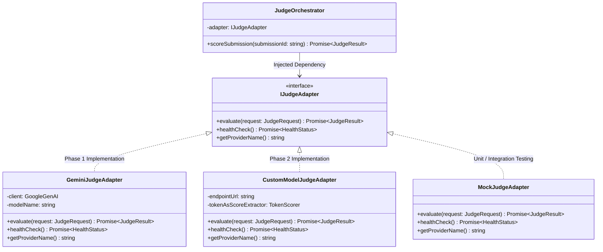
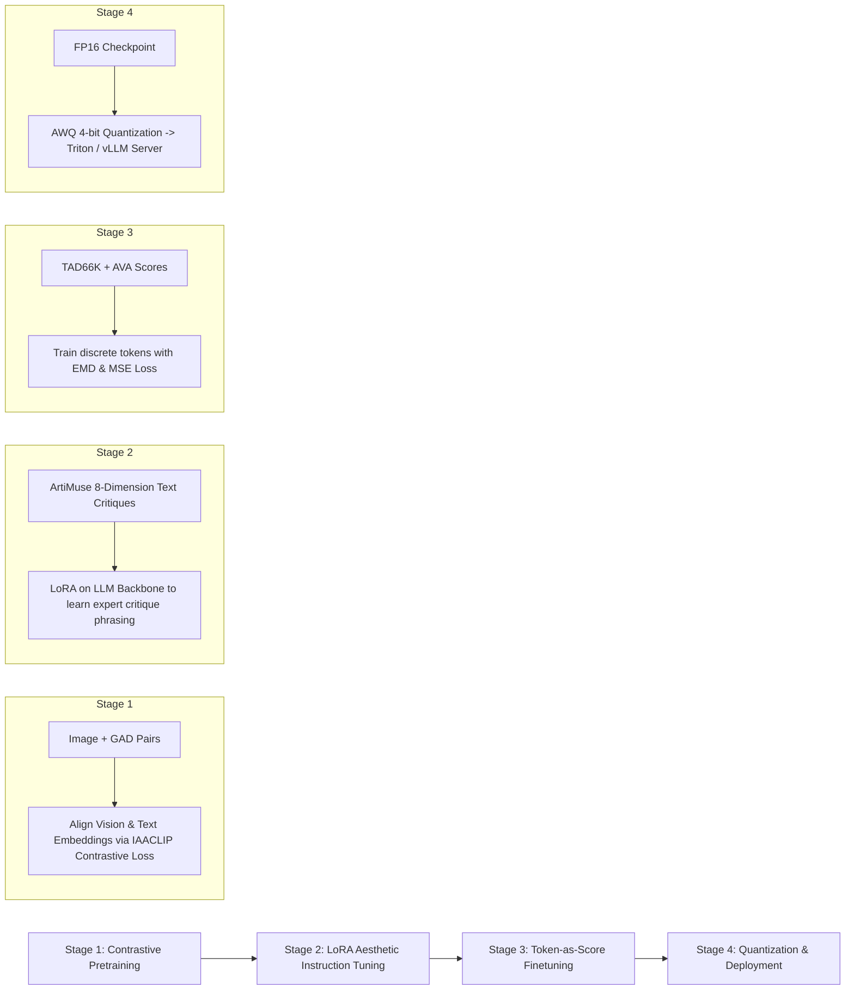

# 07: Model Abstraction & Migration Guide

> **Document Version:** 1.0.0  
> **Status:** Approved Baseline  
> **Target Audience:** AI Engineers, Backend Architects, MLOps Engineers  
> **Core Requirement:** Zero-downtime swap from hosted Gemini API (Phase 1) to custom trained model (Phase 2)  
> **Related Documents:**  
> - [01_project_overview.md](file:///c:/Users/prems/OneDrive/Desktop/projects/Image-Aesthetics-Assessment-/docs/01_project_overview.md)  
> - [05_ai_judging_system.md](file:///c:/Users/prems/OneDrive/Desktop/projects/Image-Aesthetics-Assessment-/docs/05_ai_judging_system.md)  
> - [06_prompt_library.md](file:///c:/Users/prems/OneDrive/Desktop/projects/Image-Aesthetics-Assessment-/docs/06_prompt_library.md)  
> - [08_system_architecture.md](file:///c:/Users/prems/OneDrive/Desktop/projects/Image-Aesthetics-Assessment-/docs/08_system_architecture.md)

---

## 1. The Model-Agnostic Adapter Pattern

To prevent vendor lock-in and guarantee that migrating to an in-house trained model requires zero changes in the database schema, business logic, or frontend UI, all judging operations are decoupled through the **`IJudgeAdapter`** abstraction contract.



---

## 2. Interface Definitions & Contracts

### 2.1 TypeScript Core Interface (`judge.interface.ts`)

```typescript
export interface JudgeRequest {
  submissionId: string;
  imageBuffer: Buffer;
  mimeType: 'image/jpeg' | 'image/png' | 'image/webp';
  imageUrl: string;
  category: {
    code: string;
    name: string;
    description: string;
    weights: {
      composition: number;
      lighting: number;
      colorHarmony: number;
      technicalExecution: number;
      subjectStory: number;
      originality: number;
      emotionAtmosphere: number;
      overallGestalt: number;
    };
  };
  metadata: {
    title: string;
    story?: string;
    exif?: Record<string, any>;
  };
  options?: {
    numPasses?: number;      // Default 1; 3 for calibration
    temperature?: number;    // Default 0.2
  };
}

export interface JudgeResult {
  provider: 'gemini' | 'custom_model' | 'mock';
  modelVersion: string;
  latencyMs: number;
  overallScore: number;                 // 0.0 to 100.0
  themeAdherenceScore: number;          // 0.0 to 100.0
  attributeScores: {
    composition: number;
    lighting: number;
    colorHarmony: number;
    technicalExecution: number;
    subjectStory: number;
    originality: number;
    emotionAtmosphere: number;
    overallGestalt: number;
  };
  detectedCompositionRules: string[];
  defectDeductions: {
    totalPenalty: number;
    detectedDefects: Array<{
      defectCode: string;
      penaltyPoints: number;
      description: string;
    }>;
  };
  critique: {
    strengths: string;
    technicalAnalysis: string;
    recommendations: string;
  };
  forensicsSummary: {
    syntheticLikelihood: number;
    isLikelyAuthenticPhoto: boolean;
    forensicNotes: string;
  };
  rawOutput?: Record<string, any>;
}

export interface IJudgeAdapter {
  evaluate(request: JudgeRequest): Promise<JudgeResult>;
  healthCheck(): Promise<{ isHealthy: boolean; details?: string }>;
  getProviderName(): string;
}
```

### 2.2 Phase 1 Implementation: `GeminiJudgeAdapter`

```typescript
import { GoogleGenAI, Type } from '@google/genai';
import { IJudgeAdapter, JudgeRequest, JudgeResult } from './judge.interface';
import { AESTHETIC_EVALUATION_SCHEMA } from './schemas';
import { SYSTEM_PROMPT_IAA_JUDGE_V1, buildRubricPrompt } from './prompts';

export class GeminiJudgeAdapter implements IJudgeAdapter {
  private ai: GoogleGenAI;
  private modelName: string;

  constructor(apiKey: string, modelName = 'gemini-2.5-flash') {
    this.ai = new GoogleGenAI({ apiKey });
    this.modelName = modelName;
  }

  getProviderName(): string {
    return 'gemini';
  }

  async healthCheck(): Promise<{ isHealthy: boolean; details?: string }> {
    try {
      const response = await this.ai.models.generateContent({
        model: this.modelName,
        contents: 'PING',
      });
      return { isHealthy: !!response.text };
    } catch (err: any) {
      return { isHealthy: false, details: err.message };
    }
  }

  async evaluate(request: JudgeRequest): Promise<JudgeResult> {
    const startTime = Date.now();
    const promptText = buildRubricPrompt(request);

    const response = await this.ai.models.generateContent({
      model: this.modelName,
      config: {
        systemInstruction: SYSTEM_PROMPT_IAA_JUDGE_V1,
        temperature: request.options?.temperature ?? 0.2,
        topP: 0.95,
        responseMimeType: 'application/json',
        responseSchema: AESTHETIC_EVALUATION_SCHEMA,
      },
      contents: [
        {
          inlineData: {
            mimeType: request.mimeType,
            data: request.imageBuffer.toString('base64'),
          },
        },
        { text: promptText },
      ],
    });

    const parsed = JSON.parse(response.text || '{}');
    const latencyMs = Date.now() - startTime;

    return {
      provider: 'gemini',
      modelVersion: this.modelName,
      latencyMs,
      overallScore: parsed.overallScore,
      themeAdherenceScore: parsed.themeAdherenceScore,
      attributeScores: parsed.attributeScores,
      detectedCompositionRules: parsed.detectedCompositionRules ?? [],
      defectDeductions: parsed.defectDeductions,
      critique: parsed.critique,
      forensicsSummary: parsed.forensicsSummary,
      rawOutput: parsed,
    };
  }
}
```

### 2.3 Factory Provider Switch (`judge.factory.ts`)

Switching the judging engine is governed entirely by an environment variable without touching business services:

```typescript
export function createJudgeAdapter(): IJudgeAdapter {
  const provider = process.env.JUDGE_PROVIDER || 'gemini';

  switch (provider.toLowerCase()) {
    case 'gemini':
      return new GeminiJudgeAdapter(
        process.env.GEMINI_API_KEY!,
        process.env.GEMINI_MODEL_NAME || 'gemini-2.5-flash'
      );
    case 'custom_model':
      return new CustomModelJudgeAdapter(
        process.env.CUSTOM_MODEL_ENDPOINT || 'http://localhost:8000/v1/evaluate',
        process.env.CUSTOM_MODEL_SECRET
      );
    case 'mock':
    default:
      return new MockJudgeAdapter();
  }
}
```

---

## 3. Phase 2: In-House Model Training Plan

### 3.1 Scientific Foundation & Architecture Selection
In Phase 2, the hosted API is replaced by a specialized model trained on computational aesthetics literature extracted in [00_source_inventory.md](file:///c:/Users/prems/OneDrive/Desktop/projects/Image-Aesthetics-Assessment-/docs/00_source_inventory.md):
- **Base Architecture:** Multimodal Vision-Language Model backbone (**InternVL2-8B** or **Qwen2-VL-7B**) incorporating:
  1. **Theme-Conditioned Parameter Generator (inspired by TANet / TAD66K - Paper 3):** Pre-trained on scene classification to modulate aesthetic weights.
  2. **Multi-Branch Emotion Fusion (inspired by EAMB-Net - IEEE TIM 2024):** Injects spatial emotion maps into the aesthetic representation.
  3. **Multimodal Compact Bilinear Pooling (MCBP) (inspired by IAACLIP - Paper 4):** Fuses visual tokens with prompt descriptors via Count Sketch and FFT/IFFT.
- **Scoring Strategy:** **Token-as-Score** formulation (*Cao et al., ArtiMuse, Paper 2*):
  Instead of fragile text generation, designate 101 discrete vocabulary tokens (`[Aes_0]` to `[Aes_100]`) and derive continuous scores via the expected value across the predicted logit distribution:
  $$S_{Aes} = \sum_{i=0}^{100} i \cdot p_i = \sum_{i=0}^{100} i \cdot \frac{e^{l_i}}{\sum_{j=0}^{100} e^{l_j}}$$

### 3.2 Dataset Assembly & Preprocessing
To train the custom model, we merge five complementary datasets:
1. **ArtiMuse-10K (Paper 2):** 10,000 images with paired expert structural critiques across the 8 attributes.
2. **TAD66K (Paper 3):** 66,000 images densely rated across 47 themes by 1,200 annotators per image (supplies ground truth $S_{theme}$ and category variance).
3. **AVA (Aesthetic Visual Analysis):** 255,000 images providing large-scale baseline aesthetic score distributions.
4. **PARA (Paper 4):** 31,000 images annotated with emotion tags and aesthetic descriptions.
5. **Synthetic Adversarial Benchmark (In-house):** 5,000 paired real vs. Midjourney v6/SDXL/Flux images for forensic training.

### 3.3 Training Pipeline Stages



### 3.4 Evaluation Metrics & Benchmark Targets
Before Phase 2 can replace Phase 1, the custom checkpoint must satisfy minimum benchmark criteria:
- **Spearman's Rank Correlation Coefficient (SRCC):** $\ge 0.76$ on TAD66K validation split; $\ge 0.74$ on AVA test split.
- **Pearson Linear Correlation Coefficient (PLCC):** $\ge 0.77$ on TAD66K validation split.
- **Earth Mover's Distance (EMD):** $\le 0.045$ on score distribution estimation.
- **Human-AI Agreement:** Qualitative blind evaluation where 3 professional photographers rate 100 generated critiques; $\ge 85\%$ must be rated "Equivalent or Superior to Human Juror Feedback".

---

## 4. Step-by-Step Migration Checklist

When transitioning production from Phase 1 to Phase 2, follow this rigorous operational checklist:

- [ ] **Milestone 2.1: Model Training & Evaluation**
  - [ ] Train LoRA weights on InternVL/Qwen2-VL using assembled aesthetic datasets.
  - [ ] Verify validation SRCC $\ge 0.76$ and PLCC $\ge 0.77$.
  - [ ] Export weights to HuggingFace SafeTensors and optimize via AWQ 4-bit quantization.
- [ ] **Milestone 2.2: Microservice Packaging**
  - [ ] Implement FastAPI inference wrapper serving the `JudgeResult` schema.
  - [ ] Package Docker container with CUDA 12.4 runtime and vLLM / Triton server.
  - [ ] Deploy to dedicated GPU instance (e.g., RunPod / AWS EC2 g5.xlarge with NVIDIA A10G).
- [ ] **Milestone 2.3: Shadow Canary Deployment (Dual-Running)**
  - [ ] Configure `JudgeOrchestrator` to dispatch requests to **both** Gemini and the Custom Model in background shadow mode.
  - [ ] Log score deltas and SRCC agreement across 500 live competition submissions.
  - [ ] Verify latency: Custom Model p95 latency $\le 3,500\text{ms}$ (faster and cheaper than Gemini).
- [ ] **Milestone 2.4: Production Cutover**
  - [ ] In production environment config, update:
    ```bash
    JUDGE_PROVIDER="custom_model"
    CUSTOM_MODEL_ENDPOINT="https://inference.pixelprize.internal/v1/evaluate"
    ```
  - [ ] Retain Gemini as automatic fallback (`FALLBACK_TO_GEMINI=true`) if custom model health check fails.
  - [ ] Monitor queue metrics, error rates, and participant scorecard feedback.
