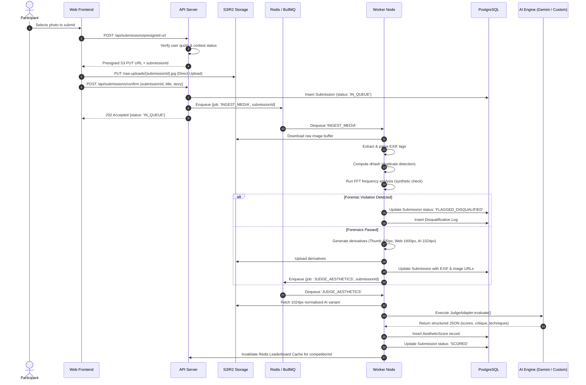

# 08: System Architecture & Infrastructure

> **Document Version:** 1.0.0  
> **Status:** Approved Baseline  
> **Target Audience:** System Architects, DevOps/SRE Engineers, Backend Developers  
> **Related Documents:**  
> - [01_project_overview.md](file:///c:/Users/prems/OneDrive/Desktop/projects/Image-Aesthetics-Assessment-/docs/01_project_overview.md)  
> - [05_ai_judging_system.md](file:///c:/Users/prems/OneDrive/Desktop/projects/Image-Aesthetics-Assessment-/docs/05_ai_judging_system.md)  
> - [07_model_abstraction_and_migration.md](file:///c:/Users/prems/OneDrive/Desktop/projects/Image-Aesthetics-Assessment-/docs/07_model_abstraction_and_migration.md)  
> - [09_tech_stack.md](file:///c:/Users/prems/OneDrive/Desktop/projects/Image-Aesthetics-Assessment-/docs/09_tech_stack.md)  
> - [10_database_schema.md](file:///c:/Users/prems/OneDrive/Desktop/projects/Image-Aesthetics-Assessment-/docs/10_database_schema.md)

---

## 1. High-Level System Architecture

The Pixel Prize platform is built as an event-driven, decoupled system consisting of five core subsystems:
1. **Client Tier (Web Application):** Next.js 15 App Router providing fast server-rendered public galleries and dynamic participant/organizer client workflows.
2. **API & Orchestration Tier:** Node.js/Next.js API routes with Prisma ORM orchestrating authentication, competition lifecycle, and job scheduling.
3. **Asynchronous Processing Tier:** Redis-backed BullMQ job queue managing distributed worker processes for image transformations, EXIF extraction, frequency forensics, and AI scoring.
4. **Data & Storage Tier:** PostgreSQL (relational metadata, competitions, submissions, scores) paired with S3-compatible object storage (Cloudflare R2 / AWS S3) and Redis (caching, rate limiting, and queue state).
5. **Aesthetic Inference Tier:** Pluggable `JudgeAdapter` communicating with hosted Multimodal LLM APIs (Phase 1) or dedicated GPU Triton inference containers (Phase 2).

```mermaid
flowchart TB
    subgraph Clients["Client Tier (Edge / Browser)"]
        Browser[Participant / Organizer / Juror Browser]
        CDN[Edge CDN / Cloudflare Caching]
    end

    subgraph AppTier["Application & API Tier (Vercel / Node.js)"]
        API[Next.js App Server / API Gateway]
        Auth[Auth Module: NextAuth / Supabase Auth]
        CompService[Competition Lifecycle Engine]
        SubService[Submission Ingestion Service]
    end

    subgraph DataTier["Data & Storage Tier"]
        DB[(PostgreSQL Primary Database)]
        Cache[(Redis Cache & Session Store)]
        S3[(Object Storage: S3 / Cloudflare R2)]
    end

    subgraph QueueTier["Asynchronous Queue Tier"]
        QueueManager[BullMQ Queue Manager (Redis)]
        Worker1[Forensic & Media Worker]
        Worker2[AI Judging Worker]
        DLQ[Dead-Letter Queue (DLQ)]
    end

    subgraph AIInferenceTier["Aesthetic Inference Tier (Decoupled)"]
        Adapter{JudgeAdapter Interface}
        Gemini[Google Gemini 2.5 API (Phase 1)]
        CustomGPU[Triton GPU Microservice: ArtiMuse / TANet (Phase 2)]
    end

    Browser <--> CDN
    CDN <--> API
    API --> Auth
    API --> CompService
    API --> SubService
    API <--> DB
    API <--> Cache
    SubService -->|Presigned URL| Browser
    Browser -->|Direct Image Upload| S3

    SubService -->|Enqueue Job| QueueManager
    QueueManager --> Worker1
    Worker1 --> S3
    Worker1 --> QueueManager
    QueueManager --> Worker2
    Worker2 --> Adapter
    Adapter -->|Phase 1| Gemini
    Adapter -->|Phase 2| CustomGPU
    Worker2 --> DB
    Worker2 -->|On Fatal Error| DLQ
```

---

## 2. Ingestion & Asynchronous Judging Pipeline

To ensure the web application never blocks on long-running image forensics or LLM API calls, all processing follows an asynchronous pipeline:



---

## 3. Storage Architecture & Image Derivative Lifecycle

Preserving photographer image quality while optimizing delivery speed and LLM token usage requires four specialized image derivatives:

| Derivative | Resolution / Specs | Format | Destination Bucket Path | Primary Purpose |
| :--- | :--- | :--- | :--- | :--- |
| **`ORIGINAL`** | Uncompressed original upload (up to $25\text{ MB}$, max $8000\times8000$) | Original (JPEG/PNG) | `/competitions/{comp_id}/original/{id}.ext` | Master archival record, dispute resolution, human juror 100% zoom. |
| **`WEB_DISPLAY`**| Long edge resized to $1600\text{px}$, quality $85$, strip EXIF | WebP | `/competitions/{comp_id}/web/{id}.webp` | Public gallery view, submission detail modal, responsive desktop view. |
| **`THUMBNAIL`** | Long edge resized to $400\text{px}$, quality $80$, progressive | WebP | `/competitions/{comp_id}/thumb/{id}.webp` | Masonry grid tiles, leaderboard list rows, mobile feed cards. |
| **`AI_NORMAL`** | Long edge resized to $1024\text{px}$, quality $90$, sRGB color space | JPEG | `/competitions/{comp_id}/ai_input/{id}.jpg` | Standardized input for Gemini API and Phase 2 vision models. |

### Storage Lifecycle Policy
- **Hot Tier:** Thumbnails and Web Display variants are served globally through Cloudflare CDN with `Cache-Control: public, max-age=31536000, immutable`.
- **Cold Tier (Post-Results):** 90 days after competition conclusion, `ORIGINAL` master files are moved to Cloudflare R2 Infrequent Access / AWS S3 Glacier Instant Retrieval to minimize hosting costs.

---

## 4. API Cost Control, Token Management & Rate Limiting

Calling multimodal LLMs on high-resolution images can quickly become cost-prohibitive if unoptimized. Pixel Prize applies four engineering controls:

### 4.1 Resolution Downsampling for LLM Ingestion
- Uploading a raw $24\text{ MP}$ ($6000\times4000$) image directly to Gemini consumes excessive vision tiles (over 1,600 tokens per call).
- By generating the **`AI_NORMAL`** derivative ($1024\times1024$ long edge) prior to inference:
  - Vision token consumption is capped at **258 tokens** per image on Gemini 2.5 Flash / 1.5 Flash.
  - Image size is reduced from $\sim 15\text{ MB}$ to $\sim 280\text{ KB}$, reducing network egress latency by $95\%$.

### 4.2 API Cost Projections (Phase 1)
Using Google Gemini 2.5 Flash pricing ($\sim \$0.10$ per 1M input tokens, $\sim \$0.40$ per 1M output tokens):
- Image tokens per call: $\approx 258$ tokens
- System & prompt context: $\approx 850$ tokens
- Output JSON tokens: $\approx 450$ tokens
- **Total Cost per Submission Scored:**
  $$\text{Cost} = (1108 \times \$0.00000010) + (450 \times \$0.00000040) \approx \$0.00029 \text{ USD}$$
- Scoring a large contest of $5,000\text{ submissions}$ costs:
  $$5,000 \times \$0.00029 = \mathbf{\$1.45 \text{ USD}}$$
- *Conclusion:* Phase 1 hosted LLM judging is extraordinarily cost-effective on Gemini 2.5 Flash.

### 4.3 Redis Token Bucket Rate Limiting
To prevent denial-of-service and quota exhaustion:
- Submission endpoint (`/api/submissions`): Max 5 submissions per hour per user account.
- Public read endpoints (`/api/competitions`, `/api/gallery`): Max 60 requests per minute per IP address.
- Queue Worker Concurrency: Capped at 10 concurrent requests to the Gemini API to comfortably remain under the standard quota tier (1,000 RPM).

---

## 5. Caching & High-Performance Data Access

Public galleries and live leaderboards experience high read-to-write ratios ($1000:1$). The system employs multi-level caching:

```
[Browser Cache]
      │ (Cache-Control: private, max-age=60)
      ▼
[Cloudflare Edge CDN]
      │ (Edge Cache: s-maxage=300 for public leaderboards)
      ▼
[Redis In-Memory Layer]
      │ - "comp:{id}:leaderboard" (JSON string, TTL 30s)
      │ - "comp:{id}:top10" (Sorted Set ZSET by S_total)
      │ - "user:{id}:quota" (Hash HSET)
      ▼
[PostgreSQL Database]
```

- **Leaderboard Cache Invalidation:** When a batch of submissions completes scoring in the background worker, the worker triggers an atomic invalidation of `comp:{id}:leaderboard` in Redis.
- **Blind Gallery Guard:** During the `OPEN` lifecycle state, leaderboard scores are omitted from Redis caches, ensuring public clients cannot intercept scores prematurely.
