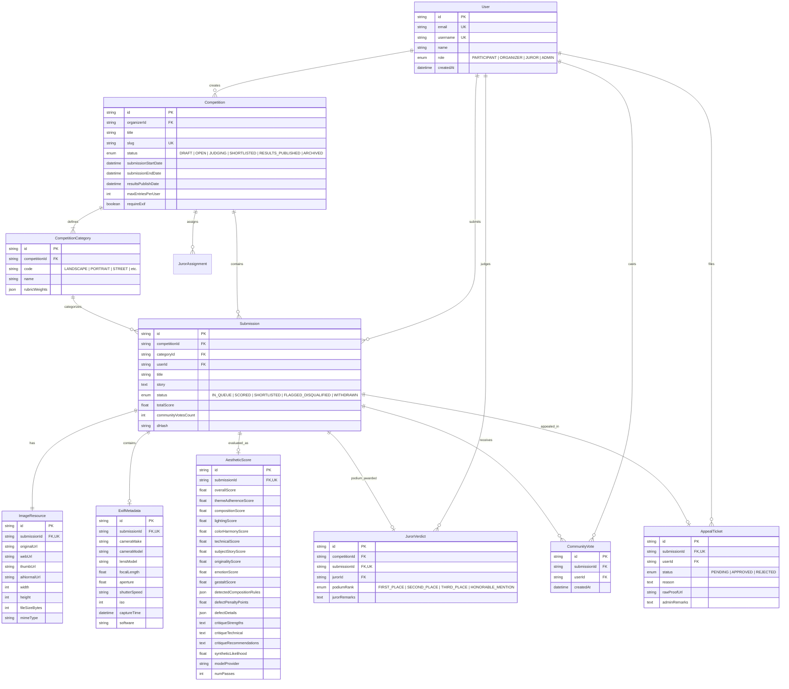

# 10: Database Schema & Entity Relationships

> **Document Version:** 1.0.0  
> **Status:** Approved Baseline  
> **Target Audience:** Database Administrators, Backend Engineers, Full-Stack Developers  
> **Scientific & Engineering Lineage:**  
> - Relational architecture expanded from *Pan Zhang (2018)* (Paper 1, Appendix A: User, Picture, Resource, Competition, Relationship)  
> - Multi-attribute and forensic extensions derived from *ArtiMuse (CVPR 2026)*, *TAD66K*, and *Presentation 1*  
> **Related Documents:**  
> - [04_competition_system.md](file:///c:/Users/prems/OneDrive/Desktop/projects/Image-Aesthetics-Assessment-/docs/04_competition_system.md)  
> - [05_ai_judging_system.md](file:///c:/Users/prems/OneDrive/Desktop/projects/Image-Aesthetics-Assessment-/docs/05_ai_judging_system.md)  
> - [08_system_architecture.md](file:///c:/Users/prems/OneDrive/Desktop/projects/Image-Aesthetics-Assessment-/docs/08_system_architecture.md)  
> - [09_tech_stack.md](file:///c:/Users/prems/OneDrive/Desktop/projects/Image-Aesthetics-Assessment-/docs/09_tech_stack.md)

---

## 1. Entity Relationship (ER) Diagram



---

## 2. Table Specifications & Data Dictionaries

### 2.1 `User` Table
Maintains system identity, authentication credentials, and user permissions across the platform.

| Column Name | Data Type | Constraints | Description |
| :--- | :--- | :--- | :--- |
| `id` | `VARCHAR(36)` | `PRIMARY KEY` (UUID/cuid) | Unique user identifier. |
| `email` | `VARCHAR(255)` | `UNIQUE, NOT NULL` | Verified email address. |
| `username` | `VARCHAR(50)` | `UNIQUE, NOT NULL` | Public handle displayed on profiles and showcase. |
| `passwordHash` | `VARCHAR(255)` | `NULLABLE` | Bcrypt/Argon2 password hash (null if OAuth). |
| `name` | `VARCHAR(100)` | `NOT NULL` | Full display name. |
| `avatarUrl` | `VARCHAR(512)` | `NULLABLE` | Profile photo URL. |
| `bio` | `TEXT` | `NULLABLE` | Short biography and artistic statement. |
| `role` | `ENUM` | `NOT NULL, DEFAULT 'PARTICIPANT'` | `PARTICIPANT`, `ORGANIZER`, `JUROR`, `ADMIN`. |
| `lifetimeWins` | `INT` | `NOT NULL, DEFAULT 0` | Total 1st, 2nd, 3rd place finishes (`GuruShots`). |
| `createdAt` | `TIMESTAMP` | `NOT NULL, DEFAULT NOW()` | Record creation timestamp. |
| `updatedAt` | `TIMESTAMP` | `NOT NULL, DEFAULT NOW()` | Last modification timestamp. |

---

### 2.2 `Competition` Table
Configures contest parameters, submission caps, deadlines, and lifecycle state.

| Column Name | Data Type | Constraints | Description |
| :--- | :--- | :--- | :--- |
| `id` | `VARCHAR(36)` | `PRIMARY KEY` | Unique competition identifier. |
| `organizerId` | `VARCHAR(36)` | `FOREIGN KEY (User.id)` | ID of the organizing user/entity. |
| `title` | `VARCHAR(200)` | `NOT NULL` | Competition title. |
| `slug` | `VARCHAR(220)` | `UNIQUE, NOT NULL` | URL-friendly slug. |
| `description` | `TEXT` | `NOT NULL` | Comprehensive overview, rules, and guidance. |
| `bannerUrl` | `VARCHAR(512)` | `NOT NULL` | Hero header image for contest page. |
| `status` | `ENUM` | `NOT NULL, DEFAULT 'DRAFT'` | `DRAFT`, `OPEN`, `JUDGING`, `SHORTLISTED`, `RESULTS_PUBLISHED`, `ARCHIVED`. |
| `submissionStartDate`| `TIMESTAMP`| `NOT NULL` | Instant when submissions open. |
| `submissionEndDate` | `TIMESTAMP`| `NOT NULL` | Strict deadline for photo submissions. |
| `resultsPublishDate` | `TIMESTAMP`| `NOT NULL` | Date when final rankings become public. |
| `maxEntriesPerUser` | `INT` | `NOT NULL, DEFAULT 2` | Maximum photo entries allowed per entrant ($1\text{ to }5$). |
| `requireExif` | `BOOLEAN` | `NOT NULL, DEFAULT TRUE` | Whether camera hardware metadata is mandatory. |
| `prizeSummary` | `VARCHAR(255)`| `NOT NULL` | E.g., "$3,000 Cash Purse + Sony Alpha Gear". |
| `createdAt` | `TIMESTAMP` | `NOT NULL, DEFAULT NOW()` | Creation timestamp. |

---

### 2.3 `CompetitionCategory` Table
Defines categories/themes and custom rubric weights for each contest (*TAD66K* principle).

| Column Name | Data Type | Constraints | Description |
| :--- | :--- | :--- | :--- |
| `id` | `VARCHAR(36)` | `PRIMARY KEY` | Unique category identifier. |
| `competitionId` | `VARCHAR(36)` | `FOREIGN KEY (Competition.id)` | Parent competition. |
| `code` | `VARCHAR(50)` | `NOT NULL` | E.g., `LANDSCAPE`, `PORTRAIT`, `STREET`, `MACRO`. |
| `name` | `VARCHAR(100)` | `NOT NULL` | Human-readable title (e.g., "Urban Street Life"). |
| `description` | `TEXT` | `NOT NULL` | Detailed criteria for this specific theme. |
| `rubricWeights` | `JSONB` | `NOT NULL` | JSON object containing 8 weights summing to $1.0$. |

---

### 2.4 `Submission` Table
Tracks individual photo entries, lifecycle statuses, and calculated ranks.

| Column Name | Data Type | Constraints | Description |
| :--- | :--- | :--- | :--- |
| `id` | `VARCHAR(36)` | `PRIMARY KEY` | Unique submission identifier. |
| `competitionId` | `VARCHAR(36)` | `FOREIGN KEY (Competition.id)` | Enrolled competition. |
| `categoryId` | `VARCHAR(36)` | `FOREIGN KEY (CompetitionCategory.id)`| Enrolled category. |
| `userId` | `VARCHAR(36)` | `FOREIGN KEY (User.id)` | Submitting photographer. |
| `title` | `VARCHAR(120)` | `NOT NULL` | Photographer-given photo title. |
| `story` | `TEXT` | `NULLABLE` | Context, intent, or background story. |
| `status` | `ENUM` | `NOT NULL, DEFAULT 'IN_QUEUE'`| `IN_QUEUE`, `SCORED`, `SHORTLISTED`, `FLAGGED_DISQUALIFIED`, `WITHDRAWN`. |
| `totalScore` | `DECIMAL(5,2)`| `NULLABLE` | Normalized overall score $S_{total} \in [0, 100]$. |
| `categoryRank` | `INT` | `NULLABLE` | Final calculated standing in category. |
| `communityVotesCount`| `INT` | `NOT NULL, DEFAULT 0` | Total validated upvotes received. |
| `dHash` | `VARCHAR(16)` | `NOT NULL` | 64-bit difference hash for duplicate checks. |
| `disqualificationReason`| `VARCHAR(255)`| `NULLABLE` | Specific forensic or rule violation code. |
| `createdAt` | `TIMESTAMP` | `NOT NULL, DEFAULT NOW()` | Upload timestamp. |

---

### 2.5 `AestheticScore` Table
Persists the granular AI evaluation results, 8 sub-scores, radar values, and critiques (*ArtiMuse* format).

| Column Name | Data Type | Constraints | Description |
| :--- | :--- | :--- | :--- |
| `id` | `VARCHAR(36)` | `PRIMARY KEY` | Unique score record ID. |
| `submissionId` | `VARCHAR(36)` | `UNIQUE, FOREIGN KEY` | Target submission. |
| `overallScore` | `DECIMAL(5,2)`| `NOT NULL` | Final calculated score $S_{total}$. |
| `themeAdherenceScore`| `DECIMAL(5,2)`| `NOT NULL` | Theme adherence ($0\text{--}100$). |
| `compositionScore` | `DECIMAL(5,2)`| `NOT NULL` | Composition & Structure ($0\text{--}100$). |
| `lightingScore` | `DECIMAL(5,2)`| `NOT NULL` | Lighting & Exposure ($0\text{--}100$). |
| `colorHarmonyScore`| `DECIMAL(5,2)`| `NOT NULL` | Color Harmony ($0\text{--}100$). |
| `technicalScore` | `DECIMAL(5,2)`| `NOT NULL` | Technical Execution ($0\text{--}100$). |
| `subjectStoryScore`| `DECIMAL(5,2)`| `NOT NULL` | Subject & Storytelling ($0\text{--}100$). |
| `originalityScore` | `DECIMAL(5,2)`| `NOT NULL` | Originality & Creativity ($0\text{--}100$). |
| `emotionScore` | `DECIMAL(5,2)`| `NOT NULL` | Emotion & Atmosphere ($0\text{--}100$). |
| `gestaltScore` | `DECIMAL(5,2)`| `NOT NULL` | Overall Gestalt ($0\text{--}100$). |
| `detectedCompositionRules`| `JSONB` | `NOT NULL` | Array of detected IAACLIP rules. |
| `defectPenaltyPoints`| `DECIMAL(4,2)`| `NOT NULL, DEFAULT 0` | Total penalty deducted ($0\text{--}30$). |
| `defectDetails` | `JSONB` | `NOT NULL` | Array of detected defects with reasons. |
| `critiqueStrengths` | `TEXT` | `NOT NULL` | 40-50 words on artistic strengths. |
| `critiqueTechnical` | `TEXT` | `NOT NULL` | 40-50 words on technical execution. |
| `critiqueRecommendations`| `TEXT` | `NOT NULL` | 30-40 words on actionable advice. |
| `syntheticLikelihood`| `DECIMAL(4,3)`| `NOT NULL` | Forensic score ($0.000\text{ to }1.000$). |
| `modelProvider` | `VARCHAR(50)` | `NOT NULL` | `gemini-2.5-flash` or `artimuse-v2`. |
| `numPasses` | `INT` | `NOT NULL, DEFAULT 1` | 1 (standard) or 3 (calibrated). |
| `createdAt` | `TIMESTAMP` | `NOT NULL, DEFAULT NOW()` | Timestamp of evaluation. |

---

## 3. Production Prisma Schema (`schema.prisma`)

```prisma
datasource db {
  provider = "postgresql"
  url      = env("DATABASE_URL")
}

generator client {
  provider = "prisma-client-js"
}

enum Role {
  PARTICIPANT
  ORGANIZER
  JUROR
  ADMIN
}

enum CompetitionStatus {
  DRAFT
  OPEN
  JUDGING
  SHORTLISTED
  RESULTS_PUBLISHED
  ARCHIVED
}

enum SubmissionStatus {
  IN_QUEUE
  SCORED
  SHORTLISTED
  FLAGGED_DISQUALIFIED
  WITHDRAWN
}

enum PodiumRank {
  FIRST_PLACE
  SECOND_PLACE
  THIRD_PLACE
  HONORABLE_MENTION
}

enum AppealStatus {
  PENDING
  APPROVED
  REJECTED
}

model User {
  id              String           @id @default(cuid())
  email           String           @unique
  username        String           @unique
  passwordHash    String?
  name            String
  avatarUrl       String?
  bio             String?
  role            Role             @default(PARTICIPANT)
  lifetimeWins    Int              @default(0)
  createdAt       DateTime         @default(now())
  updatedAt       DateTime         @updatedAt

  competitions    Competition[]    @relation("OrganizerCompetitions")
  submissions     Submission[]
  jurorVerdicts   JurorVerdict[]
  votes           CommunityVote[]
  appeals         AppealTicket[]
  jurorAssignments JurorAssignment[]

  @@index([role])
}

model Competition {
  id                  String               @id @default(cuid())
  organizerId         String
  title               String
  slug                String               @unique
  description         String               @db.Text
  bannerUrl           String
  status              CompetitionStatus    @default(DRAFT)
  submissionStartDate DateTime
  submissionEndDate   DateTime
  resultsPublishDate  DateTime
  maxEntriesPerUser   Int                  @default(2)
  requireExif         Boolean              @default(true)
  prizeSummary        String
  createdAt           DateTime             @default(now())
  updatedAt           DateTime             @updatedAt

  organizer           User                 @relation("OrganizerCompetitions", fields: [organizerId], references: [id])
  categories          CompetitionCategory[]
  submissions         Submission[]
  jurorAssignments    JurorAssignment[]
  jurorVerdicts       JurorVerdict[]

  @@index([status, submissionEndDate])
}

model JurorAssignment {
  id            String      @id @default(cuid())
  competitionId String
  jurorId       String

  competition   Competition @relation(fields: [competitionId], references: [id], onDelete: Cascade)
  juror         User        @relation(fields: [jurorId], references: [id], onDelete: Cascade)

  @@unique([competitionId, jurorId])
}

model CompetitionCategory {
  id            String       @id @default(cuid())
  competitionId String
  code          String
  name          String
  description   String       @db.Text
  rubricWeights Json

  competition   Competition  @relation(fields: [competitionId], references: [id], onDelete: Cascade)
  submissions   Submission[]

  @@unique([competitionId, code])
}

model Submission {
  id                     String            @id @default(cuid())
  competitionId          String
  categoryId             String
  userId                 String
  title                  String
  story                  String?           @db.Text
  status                 SubmissionStatus  @default(IN_QUEUE)
  totalScore             Float?
  categoryRank           Int?
  communityVotesCount    Int               @default(0)
  dHash                  String
  disqualificationReason String?
  createdAt              DateTime          @default(now())
  updatedAt              DateTime          @updatedAt

  competition            Competition       @relation(fields: [competitionId], references: [id], onDelete: Cascade)
  category               CompetitionCategory @relation(fields: [categoryId], references: [id])
  user                   User              @relation(fields: [userId], references: [id])
  imageResource          ImageResource?
  exifMetadata           ExifMetadata?
  aestheticScore         AestheticScore?
  jurorVerdict           JurorVerdict?
  appealTicket           AppealTicket?
  votes                  CommunityVote[]

  @@index([competitionId, status, totalScore(sort: Desc)])
  @@index([userId, competitionId])
  @@index([dHash])
}

model ImageResource {
  id           String     @id @default(cuid())
  submissionId String     @unique
  originalUrl  String
  webUrl       String
  thumbUrl     String
  aiNormalUrl  String
  width        Int
  height       Int
  fileSizeBytes Int
  mimeType     String

  submission   Submission @relation(fields: [submissionId], references: [id], onDelete: Cascade)
}

model ExifMetadata {
  id           String     @id @default(cuid())
  submissionId String     @unique
  cameraMake   String?
  cameraModel  String?
  lensModel    String?
  focalLength  Float?
  aperture     Float?
  shutterSpeed String?
  iso          Int?
  captureTime  DateTime?
  software     String?

  submission   Submission @relation(fields: [submissionId], references: [id], onDelete: Cascade)
}

model AestheticScore {
  id                       String     @id @default(cuid())
  submissionId             String     @unique
  overallScore             Float
  themeAdherenceScore      Float
  compositionScore         Float
  lightingScore            Float
  colorHarmonyScore        Float
  technicalScore           Float
  subjectStoryScore        Float
  originalityScore         Float
  emotionScore             Float
  gestaltScore             Float
  detectedCompositionRules Json
  defectPenaltyPoints      Float      @default(0)
  defectDetails            Json
  critiqueStrengths        String     @db.Text
  critiqueTechnical        String     @db.Text
  critiqueRecommendations  String     @db.Text
  syntheticLikelihood      Float
  modelProvider            String
  numPasses                Int        @default(1)
  createdAt                DateTime   @default(now())

  submission               Submission @relation(fields: [submissionId], references: [id], onDelete: Cascade)

  @@index([overallScore(sort: Desc)])
}

model JurorVerdict {
  id            String      @id @default(cuid())
  competitionId String
  submissionId  String      @unique
  jurorId       String
  podiumRank    PodiumRank
  jurorRemarks  String?     @db.Text
  createdAt     DateTime    @default(now())

  competition   Competition @relation(fields: [competitionId], references: [id], onDelete: Cascade)
  submission    Submission  @relation(fields: [submissionId], references: [id], onDelete: Cascade)
  juror         User        @relation(fields: [jurorId], references: [id])
}

model CommunityVote {
  id           String     @id @default(cuid())
  submissionId String
  userId       String
  createdAt    DateTime   @default(now())

  submission   Submission @relation(fields: [submissionId], references: [id], onDelete: Cascade)
  user         User       @relation(fields: [userId], references: [id], onDelete: Cascade)

  @@unique([submissionId, userId])
}

model AppealTicket {
  id           String       @id @default(cuid())
  submissionId String       @unique
  userId       String
  status       AppealStatus @default(PENDING)
  reason       String       @db.Text
  rawProofUrl  String?
  adminRemarks String?      @db.Text
  createdAt    DateTime     @default(now())
  updatedAt    DateTime     @updatedAt

  submission   Submission   @relation(fields: [submissionId], references: [id], onDelete: Cascade)
  user         User         @relation(fields: [userId], references: [id])
}
```

---

## 4. Indexing & Query Optimization Strategy

1. **Leaderboard Index:**
   `@@index([competitionId, status, totalScore(sort: Desc)])`
   Ensures that fetching the top 100 entries for a competition's leaderboard is an instant index range scan taking $<5\text{ms}$ on 500,000 rows.
2. **Quota Check Index:**
   `@@index([userId, competitionId])`
   Allows immediate verification of whether a user has exceeded their `maxEntriesPerUser` limit before generating an upload URL.
3. **Perceptual Duplicate Hash Index:**
   `@@index([dHash])`
   Enables fast Hamming distance or exact-match checks to block near-duplicate burst uploads at scale.
