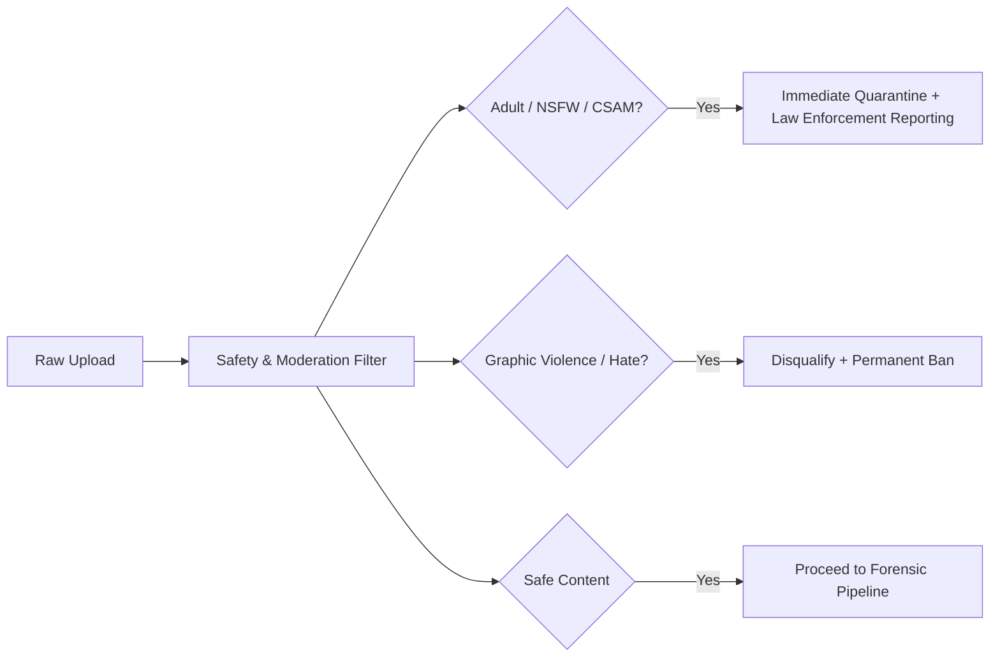

# 13: Security, Privacy, Licensing & Legal Framework

> **Document Version:** 1.0.0  
> **Status:** Approved Baseline  
> **Target Audience:** Legal Counsel, Compliance Officers, System Architects, Security Engineers  
> **Regulatory Standards:** GDPR (EU), CCPA (California), Digital Millennium Copyright Act (DMCA), C2PA Guidelines  
> **Related Documents:**  
> - [04_competition_system.md](file:///c:/Users/prems/OneDrive/Desktop/projects/Image-Aesthetics-Assessment-/docs/04_competition_system.md)  
> - [05_ai_judging_system.md](file:///c:/Users/prems/OneDrive/Desktop/projects/Image-Aesthetics-Assessment-/docs/05_ai_judging_system.md)  
> - [10_database_schema.md](file:///c:/Users/prems/OneDrive/Desktop/projects/Image-Aesthetics-Assessment-/docs/10_database_schema.md)

---

## 1. Image Copyright & Intellectual Property

A cornerstone of trust in photographer communities (*Photocrowd / 500px lessons*) is unwavering respect for intellectual property:

1. **Photographer Retention of Copyright:** The submitting photographer retains **$100\%$ full copyright, moral rights, and ownership** of their uploaded works at all times. Pixel Prize makes zero claim of ownership.
2. **Limited Platform Display License:** By entering a competition, the participant grants Pixel Prize a non-exclusive, royalty-free, worldwide license strictly to:
   - Host and display the submitted image within competition galleries, leaderboards, and winner showcases.
   - Process the image through the automated forensic and aesthetic judging pipeline.
   - Feature winning and shortlisted works in non-commercial promotional materials highlighting competition results (with mandatory photographer attribution).
3. **DMCA Takedown & Copyright Enforcement:** Pixel Prize maintains a registered DMCA agent. Any copyright holder can file a takedown notice via `/legal/dmca`. Upon receipt, infringing entries are quarantined within 24 hours pending counter-notice verification.

---

## 2. Model Training Consent & Licensing (Phase 2 Data Governance)

Training in-house Image Aesthetics Assessment models (*ArtiMuse / TAD66K* replication in Phase 2) requires strict ethical data governance:

```
+─────────────────────────────────────────────────────────────────────────────+
| MODEL TRAINING CONSENT ARCHITECTURE                                         |
+─────────────────────────────────────────────────────────────────────────────+
| [ ] (Optional Consent Checkbox at Submission):                              |
|     "I grant permission for my submitted photograph and its associated      |
|      aesthetic scores to be included in anonymized research datasets used   |
|      to train Pixel Prize's computational vision models."                   |
+─────────────────────────────────────────────────────────────────────────────+
```

### Governance Rules:
1. **Explicit, Granular Opt-In (GDPR Article 6 & 7):** Consent is strictly opt-in and cannot be pre-checked. Declining consent has **zero impact** on competition eligibility, judging scores, or prize allocation.
2. **Revocability:** Users may revoke training consent at any time via Account Settings. Revoked images are expunged from subsequent training dataset exports within 30 days.
3. **Strict Anonymization:** Data subsets exported for Phase 2 model training strip all user IDs, usernames, and profile linkages. Datasets contain only `{image_tensor, category_code, normalized_scores, critique_text}`.

---

## 3. EXIF, Geolocation & Privacy Protection

Photographic files frequently carry sensitive embedded metadata that presents privacy risks if left unchecked:

### 3.1 Geolocation & PII Stripping
- **GPS Metadata Scrubbing:** All latitude, longitude, altitude, and location name tags are **permanently stripped** from public `WEB_DISPLAY` and `THUMBNAIL` image derivatives.
- **Original Archive Preservation:** Geolocation tags are retained solely in encrypted cold storage (`ORIGINAL` bucket) for emergency forensic verification if required by organizers.
- **Publicly Visible Metadata:** Only non-PII optical camera hardware parameters are exposed to viewers:
  `Camera Make/Model`, `Lens`, `Focal Length`, `Aperture`, `Shutter Speed`, and `ISO`.

### 3.2 Facial Privacy & Biometric Non-Storage
- Pixel Prize does **not** perform biometric face recognition, user identity matching, or facial template storage.
- Portrait defect checks (*Aftershoot blink detection*) run in-memory landmark detectors (detecting eye aspect ratios) and immediately discard facial coordinates post-inference.

---

## 4. Abuse Prevention & Sybil Defense

To prevent bot swarms, malicious spam, and manipulation of the community voting track:

1. **Upload Rate Limiting & Presigned Token Expiry:**
   - Presigned upload URLs expire after $15\text{ minutes}$.
   - Max 5 upload requests per hour per user account.
2. **Sybil & Multiple Account Defense:**
   - Account registration requires email verification or authenticated OAuth (Google / GitHub).
   - Flagged IP subnets and disposable email providers are blocked.
   - Max entries enforced per competition ($1\text{ to }5$ submissions strictly enforced at the database level).
3. **Bot Mitigation on Public Track:**
   - Community voting endpoints are protected with Cloudflare Turnstile bot detection.
   - Unauthenticated or non-verified users cannot cast community votes.

---

## 5. Content Moderation & Safety

Pixel Prize maintains a safe, family-friendly platform for global festivals and academic institutions:



- **Automated Scanning:** Every image is scanned through Google Cloud Vision / Gemini Content Moderation APIs during the ingestion stage.
- **Immediate Escalation:** Any detected Child Sexual Abuse Material (CSAM) triggers immediate hash hashing, bucket deletion, user account suspension, and automated reporting to the National Center for Missing & Exploited Children (NCMEC).

---

## 6. Fairness, Explainability & AI Transparency

To counter concerns about algorithmic bias and opaque automated decision-making:

1. **Transparent Judging Notification:** Competitions explicitly declare in their rules:  
   *"Preliminary scoring is conducted by automated computer vision and multimodal AI models based on established photographic criteria. Final podium winners are selected by verified human jurors from the AI-screened Top 10 shortlist."*
2. **Equal Opportunity Blind Evaluation:** As mandated in [05_ai_judging_system.md](file:///c:/Users/prems/OneDrive/Desktop/projects/Image-Aesthetics-Assessment-/docs/05_ai_judging_system.md#L72-blind-evaluation-enforcement), photographer identity and past prestige are completely scrubbed during AI evaluation.
3. **Right to Human Appeal (GDPR Article 22 Compliance):** Entrants have a guaranteed legal right to contest an automated disqualification decision within 48 hours, routing the original image to a human organizer for manual re-evaluation.
